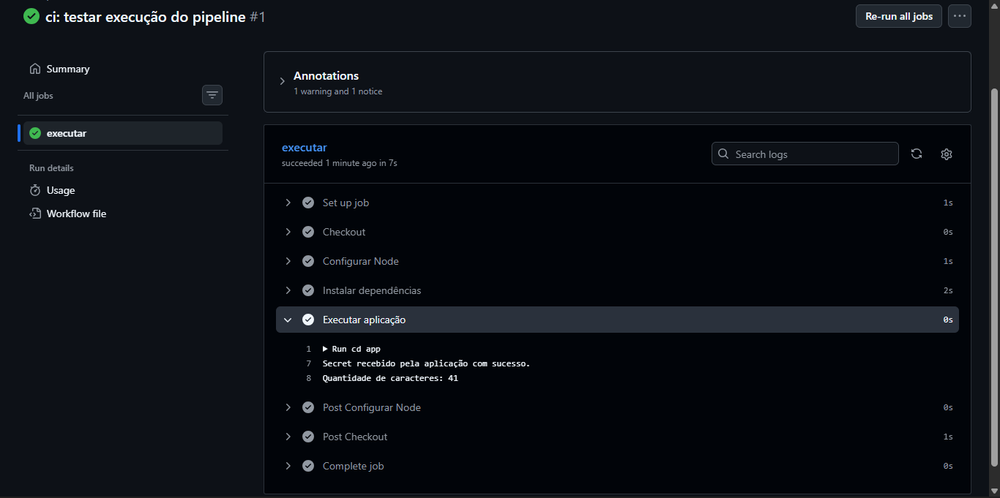

# Atividade prática — GitHub Secrets

## 1. Problema encontrado

O segredo estava armazenado diretamente no arquivo `pipeline.yml`, podendo ser visualizado por pessoas com acesso ao repositório. Essa prática não é recomendada porque pode expor senhas, tokens e outras informações confidenciais.

## 2. Secret utilizado

O nome do Secret criado foi `MENSAGEM_SECRETA`.

## 3. Como funciona

O valor é armazenado nas configurações do GitHub e disponibilizado ao GitHub Actions por meio de uma variável de ambiente. A aplicação acessa essa informação usando `process.env.MENSAGEM_SECRETA`, sem precisar armazenar o valor diretamente no código.

## 4. Respostas das questões

**1. Qual é a diferença entre armazenar o valor no pipeline e usar GitHub Secrets?**

No pipeline, o valor fica exposto no arquivo do projeto. Com GitHub Secrets, ele fica armazenado separadamente nas configurações do GitHub.

**2. Onde o Secret fica configurado?**

Em Settings → Secrets and variables → Actions → Repository secrets.

**3. O Secret deve ser colocado no código da aplicação?**

Não. Ele deve ser configurado no GitHub e disponibilizado por meio de uma variável de ambiente.

**4. Qual é a função de `process.env.MENSAGEM_SECRETA`?**

Ler o valor da variável de ambiente `MENSAGEM_SECRETA` dentro da aplicação Node.js.

**5. Por que usar Secrets em pipelines de CI/CD?**

Para evitar que informações confidenciais sejam armazenadas diretamente no código ou nos arquivos do pipeline.

**6. Por que não colocar uma senha real de banco de dados no arquivo `.yml`?**

Porque ela poderia ser exposta a pessoas com acesso ao repositório, permitindo acessos não autorizados ao banco de dados.

## 5. Evidência de execução

